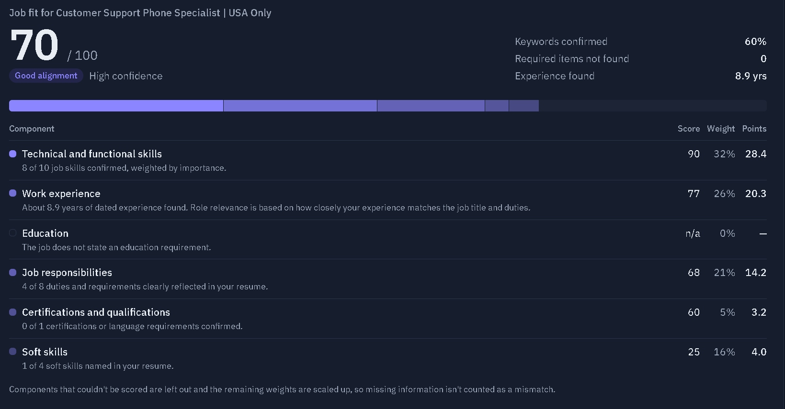
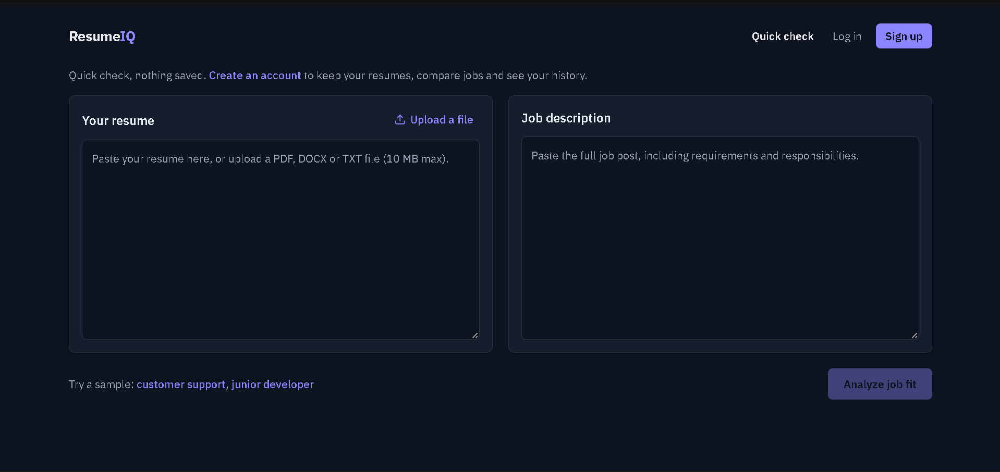
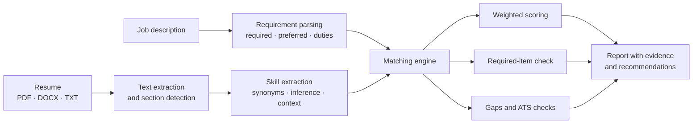

<div align="center">

# ResumeIQ

**See how well your resume matches a job, and exactly why.**

An explainable resume and job-description matcher that scores job fit, shows the evidence behind every result, and gives honest, practical advice for improving an application.

[](https://github.com/YOUR-USERNAME/resumeiq-ai-resume-job-matcher/actions/workflows/ci.yml)




</div>

---

## 📑 Contents

- [Why ResumeIQ](#-why-resumeiq)
- [Features](#-features)
- [Screenshots](#-screenshots)
- [How it works](#-how-it-works)
- [Tech stack](#-tech-stack)
- [Getting started](#-getting-started)
- [How to use the app](#-how-to-use-the-app)
- [API](#-api)
- [Testing](#-testing)
- [Security and privacy](#-security-and-privacy)
- [Project structure](#-project-structure)
- [Limitations](#-limitations)
- [Roadmap](#-roadmap)
- [License](#-license)

---

## 💡 Why ResumeIQ

Many applicants have the right experience but describe it in different words than the job post. Most resume checkers respond with an unexplained percentage. ResumeIQ shows its work instead:

- **Every match comes with evidence.** Click any keyword to see the line in the job post and the line in your resume side by side.
- **The score is explainable.** It is a weighted formula, and the report shows how many points each part contributed.
- **Required items are checked separately.** A high overall score can't hide a missing certification or degree.
- **It's honest.** ResumeIQ never suggests adding a skill you haven't confirmed you have, and it keeps "missing information" separate from real gaps.

---

## ✨ Features

| | Feature | Description |
|---|---|---|
| 📄 | **Resume parsing** | Reads PDF, DOCX and TXT files or pasted text, detects sections, contact details, education and employment dates |
| 🧾 | **Job analysis** | Classifies each requirement as required, preferred or a day-to-day duty, with an importance level |
| 🔍 | **Keyword matching** | Exact, synonym, implied, related-skill and meaning-based matches, each with evidence and a confidence level |
| 📊 | **Explainable scoring** | Weighted score across six components, configurable by job type, with a visual breakdown |
| 🚩 | **Required-item check** | Flags missing mandatory skills, certifications, degrees or years of experience on their own |
| 🧩 | **Gap analysis** | Splits missing keywords into "you have related experience" and "no evidence found" |
| 🤖 | **ATS readability** | Checks headings, contact details, dates, tables, columns, text boxes, symbols and measurable results |
| 💬 | **Recommendations** | Prioritized, evidence-based suggestions, each explaining why it was generated |
| 👤 | **Accounts** | Sign up, email verification, password reset and full account deletion |
| 🗂️ | **Saved data and history** | Save resumes and jobs, keep resume versions, and revisit every past analysis |
| ⚙️ | **Background processing** | Analyses run in the background with live status updates |
| 🌗 | **Light and dark mode** | Follows the system theme |

Works for many fields: software, IT support, customer service, sales, administration, finance, marketing, HR, healthcare administration and more.

---

## 📸 Screenshots

<table>
  <tr>
    <td width="50%"><br><sub><b>Quick check:</b> paste or upload a resume and a job post</sub></td>
    <td width="50%"><br><sub><b>Evidence:</b> every keyword shows the supporting lines</sub></td>
  </tr>
  <tr>
    <td width="50%"><br><sub><b>Dashboard:</b> saved resumes, jobs and history</sub></td>
    <td width="50%"><br><sub><b>Recommendations:</b> prioritized and explained</sub></td>
  </tr>
</table>

---

## ⚙️ How it works



### Match types

| Type | Meaning | Credit |
|---|---|---|
| ✅ Exact match | Same wording as the job | 100% |
| ✅ Synonym | Same skill, different wording ("RESTful services" for "REST APIs") | 100% |
| 🔷 Similar meaning | A resume sentence is close in meaning (non-technical skills only) | 70% |
| 🔷 Implied | Inferred, e.g. Spring Boot implies Java | 60% |
| 🟠 Related skill | Related but different (MySQL for PostgreSQL) | 35% |
| 🟠 Check this | Only in a weak context ("currently learning Docker") | 25% |
| ❌ Not found | No evidence in the resume | 0% |

Technical skills are never matched by meaning alone. "Experience with React" and "Experience with Flutter" look similar as sentences, but they are different skills.

### Scoring

The overall score is a weighted sum, **S = Σ wᵢ · sᵢ**, over six components:

| Component | Default weight |
|---|---|
| Technical and functional skills | 35% |
| Work experience | 25% |
| Job responsibilities | 15% |
| Education | 10% |
| Certifications and qualifications | 10% |
| Soft skills | 5% |

Weights change by job type. Customer service, sales and admin roles weigh duties and soft skills more and degrees less. Components that can't be scored (for example, a resume with no dates) are left out and the remaining weights are rescaled, so missing information is never counted as zero.

| Score | Meaning |
|---|---|
| 90–100 | Excellent alignment |
| 80–89 | Strong alignment |
| 70–79 | Good alignment |
| 60–69 | Moderate alignment |
| 40–59 | Low alignment |
| Below 40 | Limited alignment |

> **Note:** The score is an explainable estimate, not a hiring decision or a prediction of what any employer's ATS will do.

### Semantic similarity

ResumeIQ needs no paid AI service. It uses the best available option automatically:

1. **Sentence Transformers** (`all-MiniLM-L6-v2`), if installed, for meaning-based matching
2. **TF-IDF** (scikit-learn), the default
3. **Token overlap**, a lightweight fallback

---

## 🛠️ Tech stack

| Layer | Technology |
|---|---|
| Frontend | React 19, TypeScript, Vite, Tailwind CSS 4, React Router, Lucide icons |
| Backend | Python, FastAPI, Pydantic |
| Analysis | scikit-learn (TF-IDF), optional Sentence Transformers |
| Documents | PyMuPDF (PDF), python-docx (DOCX) |
| Database | PostgreSQL (SQLite for local development), SQLAlchemy 2, Alembic |
| Background jobs | Celery and Redis, or in-process for local development |
| Security | Argon2 password hashing, hashed session tokens, CSRF protection |
| Testing | Pytest, Vitest, React Testing Library |
| DevOps | Docker Compose, GitHub Actions |

---

## 🚀 Getting started

### Prerequisites

- [Python 3.12+](https://www.python.org/downloads/)
- [Node.js 22](https://nodejs.org/)
- [Git](https://git-scm.com/)
- [Docker](https://www.docker.com/) (optional)

### 1. Clone the repository

```bash
git clone https://github.com/YOUR-USERNAME/resumeiq-ai-resume-job-matcher.git
cd resumeiq-ai-resume-job-matcher
```

### 2. Start the backend

```bash
cd backend
python -m venv .venv
```

Activate the virtual environment:

| Windows (PowerShell) | macOS / Linux |
|---|---|
| `.venv\Scripts\Activate.ps1` | `source .venv/bin/activate` |

Then install, set up the database, and run:

```bash
pip install -r requirements-dev.txt
alembic upgrade head
uvicorn app.main:app --reload
```

The API runs at **http://localhost:8000**, with interactive docs at **http://localhost:8000/docs**.

> 💡 For better meaning-based matching, install `requirements-ml.txt` instead (downloads about 90 MB the first time).

### 3. Start the frontend

In a second terminal:

```bash
cd frontend
npm install
npm run dev
```

Open **http://localhost:5173**.

### Alternative: Docker

```bash
docker compose up --build
```

This starts PostgreSQL, Redis, the API, a background worker and the frontend. Open **http://localhost:8080**.

---

## 🧭 How to use the app

### Quick check (no account)

1. Open the home page.
2. Click **Try a sample** to load example documents, or paste your own resume (or upload a PDF, DOCX or TXT) and a job description.
3. Click **Analyze job fit**.
4. Read the report:
   - **Score and breakdown:** how many points each component contributed
   - **Required items:** anything mandatory that's missing
   - **Keywords:** click a row to see the evidence from both documents
   - **Gaps:** missing skills, split by whether you have related experience
   - **Duties:** which day-to-day responsibilities your resume reflects
   - **Recommendations:** what to change, in priority order
   - **ATS readability:** formatting issues that could confuse applicant tracking systems

Nothing is saved in quick-check mode.

### With an account

1. Click **Sign up** and create an account.
2. Confirm your email. In local development, the confirmation link is printed in the backend terminal.
3. On the **Dashboard**, add a resume (upload or paste) and save one or more job posts.
4. Under **New analysis**, pick a resume and a job, then click **Analyze**.
5. Every analysis is saved under **Analysis history**. Open any of them again, or click **Run again**.
6. You can delete individual resumes and jobs, or delete your whole account and all its data.

---

## 🔌 API

Base URL: `/api/v1`. Full interactive documentation is at `/docs` when the backend is running. Write requests must include the header `X-Requested-With: ResumeIQ`.

| Area | Endpoints |
|---|---|
| Guest | `POST /analyses/guest`, `POST /resumes/parse`, `POST /jobs/parse` |
| Auth | `POST /auth/register`, `/auth/login`, `/auth/logout`, `/auth/verify-email`, `/auth/forgot-password`, `/auth/reset-password`, `GET /auth/me`, `DELETE /account` |
| Resumes | `POST /resumes/upload`, `POST /resumes/text`, `GET /resumes`, `GET/PUT/DELETE /resumes/{id}`, `GET/POST /resumes/{id}/versions` |
| Jobs | `POST /jobs`, `GET /jobs`, `GET/PUT/DELETE /jobs/{id}` |
| Analyses | `POST /analyses`, `GET /analyses`, `GET /analyses/{id}`, `POST /analyses/{id}/reanalyze` |

Example guest analysis:

```bash
curl -H "X-Requested-With: ResumeIQ" \
     -F job_text="$(cat backend/tests/fixtures/job_customer_support.txt)" \
     -F resume_file=@backend/tests/fixtures/resume_call_agent.txt \
     http://localhost:8000/api/v1/analyses/guest
```

---

## 🧪 Testing

```bash
cd backend && python -m pytest -q
cd frontend && npm test
```

The backend suite covers document extraction (including corrupted, disguised, oversized and scanned files), every match type, the weighted formula, unknown-data handling, required-item flagging, truthfulness of recommendations, prompt-injection handling, accounts, password reset, resume versions and cross-user privacy. GitHub Actions runs both suites on every push.

---

## 🔒 Security and privacy

| Area | Approach |
|---|---|
| Passwords | Argon2id hashing; login errors don't reveal which emails have accounts |
| Sessions | Random token in an HttpOnly, SameSite cookie; only its hash is stored |
| CSRF | Every write request requires a custom header that cross-site forms can't send |
| Ownership | Users can only reach their own data; other users' IDs return "not found" |
| Files | Private storage with random file names, deleted along with the resume |
| Account deletion | Removes every file and database record |
| AI safety | Text in a resume that tries to instruct an AI is ignored and flagged |
| Rate limiting | Limits on requests, saved items and daily analyses |

---

## 📁 Project structure

```
resumeiq/
├── backend/
│   ├── app/
│   │   ├── engine/          # analysis engine (parsing, matching, scoring, ATS, recommendations)
│   │   ├── routers/         # auth, resumes, jobs, analyses
│   │   ├── main.py          # FastAPI app and guest endpoints
│   │   ├── db_models.py     # database tables
│   │   ├── security.py      # passwords, sessions
│   │   └── tasks.py         # background analyses
│   ├── migrations/          # Alembic database migrations
│   └── tests/               # Pytest suite and sample documents
├── frontend/
│   └── src/
│       ├── pages/           # quick check, dashboard, analysis, account pages
│       └── components/      # report, score breakdown, keyword table, etc.
├── docker-compose.yml
└── .github/workflows/ci.yml
```

---

## ⚠️ Limitations

- The built-in skill dictionary (about 160 skills) drives precision. Skills it doesn't know are assessed only by sentence similarity.
- With the default TF-IDF backend, paraphrases that share no words can be missed. Installing Sentence Transformers improves this.
- Scanned PDFs are detected, but OCR isn't performed yet.
- Development emails are printed to the log; production needs a mail provider.

---

## 🗺️ Roadmap

- [x] **Stage 1:** analysis engine, scoring, ATS checks, recommendations, API and UI
- [x] **Stage 2:** accounts, database, saved resumes and jobs, versions, history, background jobs
- [ ] **Stage 3:** resume editor with side-by-side suggestions, optional AI rewriting, OCR
- [ ] **Stage 4:** multi-job comparison, application tracker, analytics dashboard
- [ ] **Stage 5:** resume export templates (PDF/DOCX), admin dashboard, end-to-end tests

---

## 📄 License

Released under the [MIT License](LICENSE).

---

<div align="center">

Built by **[YOUR NAME](https://github.com/YOUR-USERNAME)**

If you find this project useful, consider giving it a ⭐

</div>
